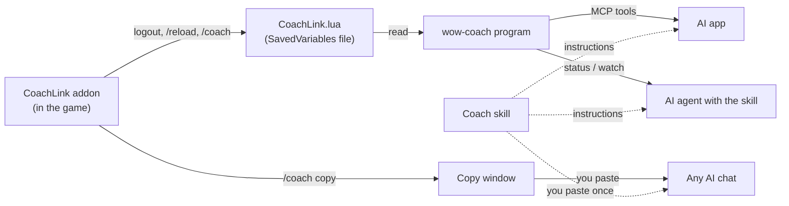

# How wow-coach works

This page explains the pieces of wow-coach, how data moves between them, and what we
verified about WoW Forever. You do not need it to use the project. It helps if you want to
fix something or add a feature.

## The idea in one paragraph

A World of Warcraft addon cannot talk to the internet or to other programs. The only thing it
can do outside the game is **save a Lua file when you log out or type `/reload`**. WoW calls
these files "SavedVariables". So the CoachLink addon writes a snapshot of your character
(level, zone, quests, talents, gear...) into that file. Then one of three things reads it:
you copy it from a window in the game (`/coach copy`), the `wow-coach` program reads the file
and hands it to an AI app (MCP), or an agent runs `wow-coach status`.

## The pieces

| Piece | Where | Language | Job |
|---|---|---|---|
| CoachLink addon | `addon/CoachLink/` | Lua | Builds the snapshot and history, saves them, shows the copy window |
| `wow-coach` program | `src/wow_coach/` | Python 3.14 | Finds and reads the saved file; commands `status`, `watch`, `check`, `mcp`, `wiki`; the MCP server; coach notes; game lookups |
| Coach skill | `skills/wow-coach/SKILL.md` | Markdown | Tells an AI how to coach |
| Tests | `tests/`, `addon/tests/` | Python, Lua | Python tests, and a Lua test run with a fake WoW API |

## Data flow



The addon never sends anything over the network. The AI app you choose sends what it reads to
its AI provider, like anything else you type there.

## Data contract: `CoachLink.lua` (formatVersion 1)

The addon owns this format. The Python reader must accept everything below and must not
crash on missing fields: every field except `savedAt` and `name` is optional, because any
game call can fail in a new game build.

```lua
CoachLinkDB = {
  ["formatVersion"] = 1,
  ["characters"] = {
    ["Testchar-SomeRealm"] = {         -- key is "Name-Realm"
      ["snapshot"] = { ... },          -- see the table below
      ["history"] = { {event}, ... },  -- oldest first, at most 300 entries
    },
  },
}
```

### Snapshot fields

| Field | Type | Meaning |
|---|---|---|
| `savedAt` | number | Unix time (seconds) when the snapshot was taken |
| `reason` | string | Why it was taken: `"logout"` (logout, exit or a plain `/reload`) or `"coach"` (the `/coach` command) |
| `name`, `realm`, `race`, `class` | string | Character identity, in the game's language (for example `"Undead"`, `"Mage"`) |
| `level` | number | Character level (1-60) |
| `xp`, `xpMax` | number | XP into the current level, and XP needed for the next |
| `restedXP` | number | Bonus (rested) XP left. Missing means none |
| `money` | number | Copper. 100 copper = 1 silver, 100 silver = 1 gold |
| `zone`, `subZone` | string | For example `"Tirisfal Glades"`, `"Brill"` |
| `mapID` | number | Map id used by the game's UI |
| `x`, `y` | number | Map coordinates 0-100 (missing inside dungeons) |
| `hearth` | string | Where the Hearthstone is set |
| `bags` | table | `{ free = n, total = n }` bag slots |
| `quests` | list | `{ questID, title, level, complete (bool), objectives = list of { text, done (bool) } }` |
| `talents` | table | `{ unspent = n, trees = list of { name, spent }, picked = list of { name, rank, maxRank } }` |
| `professions` | list | Every Skills-tab line, each name once: `{ name, rank, maxRank, category }`. `category` is the header the line sat under, in the game's language (`"Professions"`, `"Secondary Skills"`, `"Weapon Skills"`, `"Languages"`...). `category` is optional: older snapshots lack it and can list a profession twice. The report hides lines whose maxRank is 1, shows weapon skills on their own line and hides languages |
| `gear` | list | `{ slot, name, itemLevel, quality }`; quality 0 gray, 1 white, 2 green, 3 blue, 4 purple, 5 orange |
| `spells` | list | Names of known spells (strings) |
| `errors` | list | Strings naming sections the addon failed to read, for example `"talents: attempt to index nil"` |

### History event fields

| Field | Type | Meaning |
|---|---|---|
| `time` | number | Unix time (seconds) |
| `kind` | string | `"level"`, `"death"`, `"quest"`, `"login"` |
| `text` | string | A sentence, for example `"Reached level 7"`, `"Died in Brill (level 6)"` |
| `level` | number | Character level at the time |
| `zone` | string | Zone at the time |

### How WoW Forever writes the file (seen 2026-11-06, build 1.60.1)

Checked against the game's own `Blizzard_CombatLog.lua` SavedVariables file:

- Windows line endings (`\r\n`), and the file starts with an empty line.
- No indentation.
- Keys are written as `["text"] = value,` or `[0] = value,` (number keys in brackets).
- List entries are written without a key, one per line, and holes are written as `nil,`.
  Older WoW versions add a comment after list entries: `value, -- [1]`. The reader accepts both.
- Strings use double quotes with backslash escapes (`\"`, `\\`, `\n`).
- Booleans are `true` / `false`; numbers can be integers, decimals, or negative.

## Verified facts about WoW Forever

- Forever (product code `wowf`, codename "camelot" in Blizzard's UI code) runs on the modern
  WoW engine. Its addon API is the retail-style one: `C_QuestLog.GetInfo`,
  `C_QuestLog.GetQuestObjectives`, `C_SkillInfo.GetSkillLineInfo`, `C_SpellBook`. Source:
  Blizzard's UI code, mirrored at https://github.com/Gethe/wow-ui-source (branch `forever`,
  build 1.60.1.70790), folder `Interface/AddOns/Blizzard_APIDocumentationGenerated/`.
- Forever talents are three classic-style trees built on the modern `C_Traits` system.
  Blizzard's Forever talent frame gets the config with
  `C_SpecializationInfo.GetCombatConfigIDForSpecGroup(C_SpecializationInfo.GetActiveSpecGroup())`
  and the per-tree points with `C_Traits.GetGroupDisplayInfoByTreeID` and
  `C_Traits.GetGroupCurrencyInfo`. Source: `Blizzard_PlayerSpells/Camelot/ClassTalents/` in the
  same branch.
- The addon's `.toc` interface number for Forever 1.60.1 is `16001`.
- SavedVariables are written only on logout, `/reload`, or a clean game exit. Killing the game
  loses the write.
- New addon folders are only picked up after a full game restart, not a `/reload`.
- `/coach` saves by reloading the UI, so the file is written without logging out.
- The first `/coach` after you update the addon still saves with the old code, because the
  save runs before the reload.

## Game lookups (Warcraft Wiki)

The MCP server (and the `wow-coach wiki` command) can look up game facts so the coach does not
need slow, noisy web searches. Code: `web.py` (downloading), `wiki.py` (the two lookups),
`wikitext.py` (turning the wiki's source markup into plain text).

How it works, in plain words:

1. `search_wiki` asks the wiki's search API for page titles and shows a cleaned one-line
   snippet and the link for each.
2. `read_wiki_page` asks the wiki's parse API for a page's source text, then `wikitext.py`
   pulls the info box (name, level, location...) out, turns coordinates like
   `{{co|61|52|Tirisfal Glades}}` into `Tirisfal Glades 61, 52`, turns links into their text,
   turns tables into `a | b | c` rows, and drops references, HTML and templates it does not know.
   Version labels are kept: a banner such as `{{Forever only}}` becomes the note "Marked
   Forever-only on the wiki.", and `{{cw}}` / `{{fw}}` become `[Classic]` / `[Forever]`.
3. Every answer ends with a `Source:` line.

Rules we follow:

- **Source and license.** Only the Warcraft Wiki (https://warcraft.wiki.gg), through its
  official MediaWiki API (`api.php`). Its text is CC BY-SA 4.0, so each answer shows the page
  link and "Warcraft Wiki, CC BY-SA 4.0". The saved responses in `tests/fixtures/wiki/` are
  short real samples used only to test the parser; they carry the same license and come from
  the wiki pages named in their file names.
- **Politeness.** The `User-Agent` is `wow-coach/<version> (+https://github.com/RayanBayat/wow-coach)`.
  Every call adds `maxlag=5` (the wiki may refuse us when its servers are busy). Answers are
  cached in memory for 1 hour, requests to one site are at least 0.5 s apart, and every request
  times out after 10 s. When a request fails the tool returns a plain sentence (for example
  "Warcraft Wiki didn't answer (timeout). Try again or use web search.") and never crashes.
- **robots.txt.** The wiki's `robots.txt` (checked 2026-11-07) allows ordinary agents and
  states `Content-Signal: search=yes, ai-train=no, use=reference`. Lookups for a player's
  question are reference use. We never train on wiki text, never save it to disk (the cache is
  memory only) and never copy the wiki in bulk.
- **Network access is only in `web.py`.** Everything else receives a `fetch` function, so tests
  use saved responses and never touch the internet.

### Why Wowhead is not included

Wowhead has handy public JSON endpoints (a search suggestion list and a tooltip service), and
we looked at using them. We decided not to, on 2026-11-07, for two reasons:

- Wowhead's terms of use (https://corp.fanbyte.com/legal/terms, linked from
  https://www.wowhead.com/forever/tos) say you may not "attempt to access or search the
  Service or download content from the Service using any engine, software, tool, agent,
  device or mechanism (including spiders, robots, crawlers, data mining tools or the like)
  other than the software and/or search agents provided by ZAM or other generally available
  third-party web browsers". A program that queries Wowhead for an AI is that kind of tool.
- Wowhead's pages answer automated requests with 403 (bot protection). Getting around that
  would break the first point and is something this project never does.

So there are no Wowhead tools. If Wowhead publishes an official, permitted API, this can be
revisited.

### What we never do

- Never get around a site's protection: no headless browsers, no cookie or token tricks, no
  pretending to be a web browser.
- Never use a site whose terms forbid automated access.
- Never hide where an answer came from: every lookup ends with a `Source:` line.

## Known limits

- The snapshot is only as fresh as the last logout, `/reload` or `/coach`.
- Quests under a collapsed quest-log header are not saved (`C_QuestLog.GetInfo` only walks
  shown entries).
- The Lua test uses a fake game API, so it proves our logic, not Blizzard's behavior.
- There is no live combat data.

## Safety

- The addon uses only the normal addon API. There is no memory reading, no injection and no
  automation, so it is allowed under Blizzard's addon rules like any other addon.
- Every part of the snapshot is read inside a protected call. If one game function breaks in a
  patch, that part is listed under `errors` and the rest still saves.
- The program only reads the saved file. Its only write is the coach notes file.
- The addon uploads nothing. The program never sends your character anywhere. Its only
  internet use is the wiki lookups above, which send just the words being looked up.
