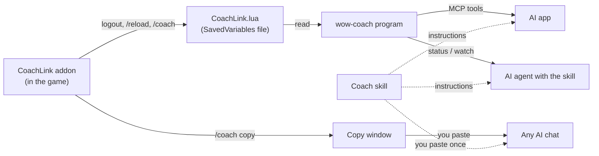

# How wow-coach works

This page explains the pieces of wow-coach, how data moves between them, and what we
verified about WoW Forever. You do not need it to use the project. It helps if you want to
fix something or add a feature.

## The idea in one paragraph

A World of Warcraft addon cannot talk to the internet or to other programs. The only thing it
can do outside the game is **save a Lua file when you log out or type `/reload`**. WoW calls
these files "SavedVariables". So the CoachLink addon writes a snapshot of your character
(level, zone, quests, talents, gear...) into that file. Then one of three things reads it:
you copy it from a window in the game (`/coach copy`), the `wow-coach` program reads the file
and hands it to an AI app (MCP), or an agent runs `wow-coach status`.

## The pieces

| Piece | Where | Language | Job |
|---|---|---|---|
| CoachLink addon | `addon/CoachLink/` | Lua | Builds the snapshot and history, saves them, shows the copy window |
| `wow-coach` program | `src/wow_coach/` | Python 3.14 | Finds and reads the saved file; commands `status`, `characters`, `progress`, `watch`, `check`, `mcp`, `wiki`; the MCP server; player notes and character journals; game lookups |
| Coach skill | `src/wow_coach/assets/skills/wow-coach/SKILL.md` | Markdown | Tells an AI how to coach, including how to plan toward a goal |
| Coach agent | `src/wow_coach/assets/agents/wow-coach.md` | Markdown | A Claude Code agent: runs a whole session (checks setup, starts live mode, asks which character to continue, greets, plans, says goodbye) and brings its own MCP server |
| Companion | `src/wow_coach/` (`companion.py`, `engine/`, `app/`, `ai/`, `triggers/`, `alerts.py`) | Python | wow-coach's own coach with the player's ChatGPT plan: `wow-coach signin`, `ask`, `app` (0.9.0) |
| Tests | `tests/`, `addon/tests/` | Python, Lua | Python tests, and a Lua test run with a fake WoW API |

## Settings, setup and the packaged Claude files

- `wow-coach setup` (`setup.py`) finds the game folder, installs or updates the addon from
  the GitHub release zip of the same version (`CoachLink-<version>.zip`), creates the notebook,
  and with `--claude-code` copies the agent and skill into `~/.claude`. It refuses zips with
  entries outside `CoachLink/` (zip slip), swaps the new addon in before deleting the old one,
  leaves symbolic links (developer copies) alone, and keeps a `.bak` of a different file it
  replaces. It writes only to the game's `Interface/AddOns/CoachLink`, the data folder and
  `~/.claude`.
- The game folder is picked in this order: `--wow-dir`, the `WOW_COACH_WOW_DIR` variable, the
  folder saved in `config.json` (data folder, override with `WOW_COACH_CONFIG_FILE`), then
  auto-detect.
- The agent and skill live inside the package (`src/wow_coach/assets/`) so that `pip` and
  `uvx` installs carry them. The agent starts the MCP server with `uvx` pinned to the release
  tag; `tests/test_release_pins.py` fails if that pin or a docs pin is not the project version.

## Data flow



The addon never sends anything over the network. The AI app you choose sends what it reads to
its AI provider, like anything else you type there.

## Data contract: `CoachLink.lua` (formatVersion 1)

The addon owns this format. The Python reader must accept everything below and must not
crash on missing fields: every field except `savedAt` and `name` is optional, because any
game call can fail in a new game build.

```lua
CoachLinkDB = {
  ["formatVersion"] = 1,
  ["characters"] = {
    ["Testchar-SomeRealm"] = {         -- key is "Name-Realm"
      ["snapshot"] = { ... },          -- see the table below
      ["history"] = { {event}, ... },  -- oldest first, at most 500 entries (300 before 0.7.0)
      ["progress"] = { {point}, ... }, -- oldest first, at most 500 points (added in 0.5.0)
    },
  },
}
```

### Snapshot fields

| Field | Type | Meaning |
|---|---|---|
| `savedAt` | number | Unix time (seconds) when the snapshot was taken |
| `reason` | string | Why it was taken: `"logout"` (logout, exit or a plain `/reload`), `"coach"` (the `/coach` command) or `"ask"` (the player asked the coach a question, 0.8.0+) |
| `name`, `realm`, `race`, `class` | string | Character identity, in the game's language (for example `"Undead"`, `"Mage"`) |
| `classFile` | string | The class in English capitals, the same in every game language (`"MAGE"`) |
| `faction` | string | `"Horde"` or `"Alliance"` |
| `guild` | table | `{ name, rank }`. Missing when not in a guild |
| `level` | number | Character level (1-60) |
| `xp`, `xpMax` | number | XP into the current level, and XP needed for the next |
| `restedXP` | number | Bonus (rested) XP left. Missing means none |
| `resting` | bool | In an inn or a city, where rested XP builds up |
| `money` | number | Copper. 100 copper = 1 silver, 100 silver = 1 gold |
| `zone`, `subZone` | string | For example `"Tirisfal Glades"`, `"Brill"` |
| `mapID` | number | Map id used by the game's UI |
| `x`, `y` | number | Map coordinates 0-100 (missing inside dungeons) |
| `instance` | table | `{ name, type }` while inside a dungeon or raid (`type` is `"party"`, `"raid"`...) |
| `hearth` | string | Where the Hearthstone is set |
| `stats` | table | `{ health, healthMax, power, powerMax, powerType ("MANA"...), attributes = list of { name, value, base }, armor, resistances = list of { school, value }, spellDamage = list of { school, value }, healing, spellCrit, meleeCrit, dodge (percent), attackPower, manaRegen, manaRegenCasting (mana per second) }` |
| `bags` | table | `{ free = n, total = n, containers = list of container }`. `free`/`total` count the backpack and the four bags. `containers` (added in 0.6.0) also lists a reagent bag or keyring when the character has one |
| `quests` | list | `{ questID, title, level, zone, complete (bool), failed (bool), suggestedGroup, objectivesText, objectives = list of { text, done (bool) } }`. `zone` is the quest-log header it sits under; `objectivesText` is the short "Bring 10 ... to ... in Brill" summary, which names who to hand it in to; `suggestedGroup` is set for group quests |
| `completedQuests` | number | How many quests the character has ever finished |
| `talents` | table | `{ unspent = n, trees = list of { name, spent }, picked = list of { name, rank, maxRank } }` |
| `professions` | list | Every Skills-tab line, each name once: `{ name, rank, maxRank, category }`. `category` is the header the line sat under, in the game's language (`"Professions"`, `"Secondary Skills"`, `"Weapon Skills"`, `"Languages"`...). `category` is optional: older snapshots lack it and can list a profession twice |
| `recipes` | list | Remembered (see below). One entry per profession window opened: `{ profession, rank, maxRank, seenAt, recipes = list of { name, color, skillUps } }`. Only learned recipes. `color` is the recipe's color in the window: `"orange"` (sure skill-up), `"yellow"`, `"green"`, `"gray"` (no skill-up) |
| `gear` | list | One item (see below) per worn slot, plus `slot` (`"Chest"`), `durability` and `durabilityMax` |
| `bank` | table | Remembered. `{ seenAt, containers = list of container }`; a container from the account bank has `account = true` |
| `mail` | table | Remembered. `{ seenAt, letters = list of { sender, subject, money, cod, daysLeft, items = list of { name, count, quality } } }` |
| `timePlayed` | table | Play time: `{ total, thisLevel, seenAt }` (seconds). The addon asks the game for it (see "Remembered fields") |
| `spells` | list | Names of learned, active spells (strings) |
| `spellBook` | list | Every learned spellbook entry: `{ tab, name, rank, passive (bool) }` |
| `reputations` | list | `{ name, group, standing, value, max, atWar }`: `standing` is the game's word (`"Friendly"`), `value`/`max` the progress inside it. A header the player collapsed in the reputation window is `{ name, collapsed = true }`, because the game hides its factions |
| `currencies` | list | `{ name, quantity }` from the Currency tab |
| `legacy` | table | Forever's Legacy system: `{ renown (reward track level), points (unspent), perks = list of { tree, name, rank, maxRank }, challenges = list of { name, done, description } }` (the class challenges) |
| `auras` | list | Buffs and debuffs right now: `{ name, kind ("buff"/"debuff"), seconds (left; missing = no end), stacks }` |
| `actionBars` | list | `{ slot, kind ("spell", "item", "macro"...), name }`. Slots 1-12 are the main bar; the other bars follow in blocks of 12 |
| `group` | table | `{ kind ("party"/"raid"), members = list of { name, level, class } }`. Missing when alone |
| `pet` | table | `{ name, level, family }`. Missing without a pet |
| `achievementPoints` | number | Achievement points |
| `mounts` | list | Names of the mounts the character owns |
| `errors` | list | Strings naming sections the addon failed to read, for example `"talents: attempt to index nil"` |
| `loggedOutAt` | number | Unix time of a logout that found the character already unloaded (see "Logging out" below). The snapshot is then the last full one, from `savedAt`. Missing otherwise |

**Containers and items.** A container (a bag, a bank tab) is
`{ bag, name, slots, free, account, items = list of item }`. An item is
`{ slot, name, itemID, count, quality, itemLevel, requiredLevel, type, subType, equipSlot, stats, sellPrice, bound, noValue }`:
quality 0 gray, 1 white, 2 green, 3 blue, 4 purple, 5 orange; `type`/`subType` are the
game's words (`"Armor"`/`"Cloth"`, `"Tradeskill"`/`"Cloth"`); `equipSlot` (`"Chest"`) and
`stats` (a list of strings like `"+3 Stamina"`) only exist for things you can wear;
`sellPrice` is copper for one item; `noValue` means vendors won't buy it.

**Gear hints.** The report's "Gear hints" section (right after the bags; Python only, in
`report_gear_hints.py`, nothing new is saved) compares bag items with the character. It
lists armor and weapons whose type has no matching `Armor Proficiencies` or `Weapon Skills`
line in `professions` (skipped when the save has no such lines), and "possible upgrades":
a usable item whose `equipSlot` maps to a worn slot that is empty, holds a lower item
level, or holds a gray item. Rings and trinkets are compared with the weaker worn one;
one-hand, two-hand and main-hand weapons with the main hand. The section is only a hint:
the coach makes the final call, and it is left out when there is nothing to say.

**Remembered fields.** The bank, the mailbox and the recipe lists can only be read while
that window is open. The addon reads them at that moment and copies the last thing it saw
(with `seenAt`, Unix time) into every snapshot, so they can be days old. Missing means
"never seen yet".

Play time only reaches addons as the answer to `/played` (the `TIME_PLAYED_MSG` event). The
addon asks for it itself with `RequestTimePlayed()` 3 seconds after logging in, after a
`/reload` and after a level-up. Every chat window prints that answer, so the windows that
listen to `TIME_PLAYED_MSG` stop listening until the answer has arrived (or 10 seconds have
passed), then listen again; the player's own `/played` still shows as usual. An answer from
this session is moved forward to the save time (play time runs while you are logged in), so
`seenAt` is then the save time. An answer from an earlier session is not, because the
offline time is unknown.

All fields added in 0.6.0 are additive: `formatVersion` stays 1, older readers ignore them,
and saves from older addons simply lack them.

### History event fields

| Field | Type | Meaning |
|---|---|---|
| `time` | number | Unix time (seconds) |
| `kind` | string | `"level"`, `"death"`, `"quest"`, `"login"`, `"item"` (added in 0.7.0) |
| `text` | string | A sentence, for example `"Reached level 7"`, `"Died in Brill (level 6)"`. A death adds what is known: `"Died in Brill (level 6). Attacked by 2 enemies: Scarlet Warrior (level 9, elite), Scarlet Friar (level 8). Killing blow: Scarlet Warrior (melee, 45 damage). 40 s after coming back to life."` |
| `level` | number | Character level at the time. For a `"level"` event it is the level reached (saves from addon 0.6.0 and older store the level before it) |
| `zone` | string | Zone at the time |
| `attackers` | list | Death only (added in 0.7.0): the enemies seen attacking in the last 10 seconds, strongest first: `{ name, level, classification, isPlayer }`. `level` -1 means "??" (far above yours); `classification` is the game's word (`"normal"`, `"elite"`, `"rareelite"`, `"rare"`, `"worldboss"`...). Missing when none was seen |
| `killer` | table | Death only: the killing blow from the game's death recap, `{ name, spell, amount }`. `spell` is `"melee"` for a plain hit, or the cause for environment damage (`"falling"`, then without `name`). Missing when the game had no recap |
| `source` | string | Item only: where it came from: `"loot"`, `"quest"` (a quest reward), `"vendor"` (bought) or `"mail"` |
| `item`, `itemID`, `quality`, `count` | | Item only: the item's name, id, quality (0 gray ... 5 orange) and how many. For a quest reward `item` is the reward the player chose (missing when there was nothing to choose) |
| `quest`, `choices`, `rewards` | | Quest reward only: the quest's title, the names of every reward offered to choose from (in the window's order) and of the rewards everyone gets |
| `price` | number | Vendor only: what it cost, in copper |
| `from` | string | Mail only: who sent the letter |
| `secondsSinceRevive` | number | Death only: seconds since the character came back to life, when that was 5 minutes or less ago (a "death loop": coming back next to the same enemies) |

**Where items came from.** Loot comes from the chat line the game prints for your own loot
(`CHAT_MSG_LOOT` matching `LOOT_ITEM_SELF` / `LOOT_ITEM_SELF_MULTIPLE`, so other players'
loot lines don't match). The rest comes from `hooksecurefunc` on the game function the window
calls: `GetQuestReward(choice)` (the quest window's Complete Quest button), `BuyMerchantItem`
and `TakeInboxItem` / `AutoLootMailItem`. Loot and purchases are only kept for things you can
wear and for green or better items; quest rewards and mail are always kept. The hook runs on
the click, so a purchase the game then refuses (not enough gold, full bags) is still recorded.

**How a death is explained.** Since game version 12, addons can't read the combat log in
Forever: `COMBAT_LOG_EVENT_UNFILTERED` is marked restricted, and `GetCurrentEventInfo` only
exists in `C_CombatLogSecure` (Blizzard's own code), not in `C_CombatLog` (checked in the
Forever UI source, `Blizzard_APIDocumentationGenerated/CombatLog*Documentation.lua`). So the
addon can't see who hit you. Instead, while the player is in combat (`PLAYER_REGEN_DISABLED`
to `PLAYER_REGEN_ENABLED`), it looks every second at `target`, `focus`, `mouseover` and
`nameplate1`-`nameplate40`, and remembers each enemy whose target is the player
(`UnitIsUnit(unit .. "target", "player")`). Enemies without a name plate are only seen when
targeted. One second after `PLAYER_DEAD` it asks `C_DeathRecap.GetRecapEvents()` for the
killing blow (the first event, as in Blizzard's recap window) and only uses it if its
`timestamp` is within 30 seconds of now. Not verified in the game: whether Forever fills the
death recap (Blizzard's recap window only loads in retail), so `killer` may stay missing.
Coming back to life is `PLAYER_UNGHOST`, or `PLAYER_ALIVE` when the player is not a ghost.

### Progress point fields

One point is added to a character's `progress` list every time a snapshot is taken (logout,
`/reload`, `/coach`). It is a small copy of the numbers that show how far the character got,
so the coach can compare sessions without keeping every snapshot. `progress` is additive:
`formatVersion` stays 1, and saves from older addon versions simply have no `progress`.

| Field | Type | Meaning |
|---|---|---|
| `time` | number | Unix time (seconds) of the snapshot |
| `reason` | string | Same as the snapshot's `reason` |
| `level`, `xp`, `xpMax` | number | Level, XP into the level, XP needed for the next |
| `money` | number | Copper |
| `zone`, `subZone` | string | Where the character was |
| `questsDone` | number | How many quests in the log were complete (ready to turn in) at that moment. Missing when the quest log could not be read |

Every field is optional: if a game call fails, the point is still added with what is known.
The reader ignores points that look unloaded (see "Logging out" below).
Rules: at most 500 points (the oldest are dropped), and a point is **not** added when
`level`, `xp`, `xpMax`, `money`, `zone`, `subZone` and `questsDone` are all the same as in the
previous point and it was taken within 60 seconds of it (quick `/reload` series).

### How WoW Forever writes the file (seen 2026-11-06, build 1.60.1)

Checked against the game's own `Blizzard_CombatLog.lua` SavedVariables file:

- Windows line endings (`\r\n`), and the file starts with an empty line.
- No indentation.
- Keys are written as `["text"] = value,` or `[0] = value,` (number keys in brackets).
- List entries are written without a key, one per line, and holes are written as `nil,`.
  Older WoW versions add a comment after list entries: `value, -- [1]`. The reader accepts both.
- Strings use double quotes with backslash escapes (`\"`, `\\`, `\n`).
- Booleans are `true` / `false`; numbers can be integers, decimals, or negative.

## Verified facts about WoW Forever

- Forever (product code `wowf`, codename "camelot" in Blizzard's UI code) runs on the modern
  WoW engine. Its addon API is the retail-style one: `C_QuestLog.GetInfo`,
  `C_QuestLog.GetQuestObjectives`, `C_SkillInfo.GetSkillLineInfo`, `C_SpellBook`. Source:
  Blizzard's UI code, mirrored at https://github.com/Gethe/wow-ui-source (branch `forever`,
  build 1.60.1.70790), folder `Interface/AddOns/Blizzard_APIDocumentationGenerated/`.
- Forever talents are three classic-style trees built on the modern `C_Traits` system.
  Blizzard's Forever talent frame gets the config with
  `C_SpecializationInfo.GetCombatConfigIDForSpecGroup(C_SpecializationInfo.GetActiveSpecGroup())`
  and the per-tree points with `C_Traits.GetGroupDisplayInfoByTreeID` and
  `C_Traits.GetGroupCurrencyInfo`. Source: `Blizzard_PlayerSpells/Camelot/ClassTalents/` in the
  same branch.
- The addon's `.toc` interface number for Forever 1.60.1 is `16001`.
- On a real logout or quit (not `/reload`), the game has already unloaded most of the
  character when `PLAYER_LOGOUT` fires: `UnitXPMax` returns 0, every bag has 0 slots, max
  health is 0, `UnitLevel` can be wrong and `C_SpellBook.GetSpellBookSkillLineInfo` returns
  nil. Seen on 2026-11-07 and 2026-11-08 ([#2](https://github.com/RayanBayat/wow-coach/issues/2)).
- SavedVariables are written only on logout, `/reload`, or a clean game exit. Killing the game
  loses the write.
- New addon folders are only picked up after a full game restart, not a `/reload`.
- `/coach` saves by reloading the UI, so the file is written without logging out.
- The first `/coach` after you update the addon still saves with the old code, because the
  save runs before the reload.

## Coach panel: questions and advice (0.8.0)

The Coach panel (`CoachLinkPanel.lua`) shows advice inside the game and lets the player ask a
question. An addon can't use the network or read files while it runs, so questions and
answers travel through files (the plan: `docs/plans/coach-panel.md`).

**Questions (game to wow-coach).** `ns.askCoach(text)` (the panel's Ask button and
`/coach ask <text>`) adds the question to the character's saved table and reloads the UI,
so WoW writes it to disk with a snapshot whose `reason` is `"ask"`. It refuses an empty
question and does nothing in combat (`InCombatLockdown()`).

```lua
["questions"] = {                 -- in CoachLinkDB.characters["Name-Realm"], oldest first
  { ["id"] = "1794100000-1", ["text"] = "What should I do next?", ["askedAt"] = 1794100000 },
},
```

- At most 20 are kept, the newest. The text is at most 500 bytes, cut on a whole letter.
- `id` is "time-counter", unique per character.
- A question whose `id` is in the advice file's `answeredIds` (or is the `questionId` of an
  answer there) counts as answered, and is dropped the next time the player asks.
  `answeredIds` is kept separately because old answers are pushed out of the file.
- Python: `Character.questions`.

**Advice (wow-coach to game).** wow-coach writes a small data-only addon of its own into the
game folder: `Interface/AddOns/CoachLink_Advice/` with `CoachLink_Advice.toc` and
`Advice.lua`.
- It is not part of the CoachLink zip, so addon managers (the CurseForge app) never overwrite
  it.
- `CoachLink.toc` lists it under `## OptionalDeps`, so it loads first when it is there.
- A new addon folder is only noticed after a full game restart.

```lua
CoachLinkAdvice = {
  ["formatVersion"] = 1,
  ["writtenAt"] = 1794100100,
  ["characters"] = {
    ["Name-Realm"] = {
      ["basedOnSave"] = 1794100050,     -- savedAt of the snapshot the coach read
      ["answers"] = {                   -- oldest first, at most 10
        { ["answeredAt"] = 1794100090, ["source"] = "Claude Code coach", ["title"] = "Next steps",
          ["steps"] = { "...", "..." }, ["text"] = "...", ["warnings"] = { "..." },
          ["questionId"] = "1794100000-1", ["question"] = "What should I do next?",
          ["askedAt"] = 1794100000 },
      },
      ["plan"] = { ["goal"] = "Level 20 by Sunday", ["steps"] = { "..." }, ["updatedAt"] = 1794100090 },
      ["answeredIds"] = { "1794100000-1" },  -- every answered question id, newest last, at most 40
    },
  },
}
```

- Every field except `answeredAt` and `title` is optional.
- The limits (steps, lengths, file size) and the Python types are in
  `src/wow_coach/advice/contract.py`.
- The file is Lua that the game runs, so wow-coach writes it with a serializer that only
  produces tables, strings, numbers and booleans:
  - It escapes `\`, `"`, line breaks and control characters.
  - It doubles `|`, so text can't make WoW color codes or links.
  - It reads the result back before using it, and replaces the file in one step (atomically).
- The addon checks every level of the table before using it (`ns.myAdvice()`).

**The panel's view of CoachLink.lua.** `CoachLinkPanel.lua` gets `ns.askCoach`,
`ns.openQuestions` (questions without an answer yet), `ns.myAdvice` (this character's
`CoachLinkAdvice` entry, or nil), `ns.characterKey` and `ns.say`, and sets
`ns.togglePanel`, which `/coach panel` calls. The `.toc` names
`CoachLink_OnAddonCompartmentClick` for the minimap's addon list.

**The panel** (`CoachLinkPanel.lua`, `Bindings.xml`):
- **Opening it:** `/coach panel`, the minimap's addon list, or a key binding (Options, then
  Keybindings, then CoachLink).
- **What it shows:** the newest answer's steps (or the plan's), its text and warnings, the
  open questions, and a footer. The footer gives who wrote it, when, and the save it was based
  on, and ends with "AI can be wrong".
- **Combat:** it hides in combat and comes back after. Ask is disabled in combat.
- **Advice text:** it type-checks and cuts every advice field again. It removes any single
  `|` (doubled `||` from wow-coach stay, and WoW draws them as a plain `|`).
- **Settings:** remembered in `CoachLinkDB.settings.panel`: `point`, `relPoint`, `x`, `y`,
  `width`, `height`, `fontSize`, `open` and `lastSeenAnswerAt`. After a reload, a single chat
  line says when there is advice the player hasn't opened yet.

**Writing the advice** (`src/wow_coach/advice/`):
- **Where:** `writer.py` writes only inside `<AddOns>/CoachLink_Advice/`.
  - It refuses symlinks and junctions for the folder, the `.toc` and `Advice.lua`.
  - It never creates the game's own folders.
  - It replaces `Advice.lua` atomically, through a temp file in the same folder
    (`.tmp-*.part`).
- **The `.toc`:** `## Interface:` (copied from `CoachLink.toc` each time, else 16001),
  `## Title`, `## Notes`, `## Version` (wow-coach's), then `Advice.lua`. No SavedVariables.
- **Limits** (`limits.py`) are enforced by cutting:
  - Blank steps are dropped, and the first 5 steps and 5 warnings are kept, in the order to
    act in.
  - The newest 10 answers are kept, and a new answer to the same `questionId` replaces the
    old one.
  - The file is refused above 200,000 bytes.
- **Reading back:** the reader turns `||` back into `|`.
- **The coach's tools:** `questions_from_game` and `send_advice_to_game` (`advice/tools.py`)
  are the MCP tools. `wow-coach setup` creates the folder after installing the addon. The
  watcher adds "N open question(s)" to a save with `reason: ask`.
- **Tests:**
  - `tests/test_advice_luajit.py` loads written files in LuaJIT.
  - `tests/test_panel_end_to_end.py` writes an answer with the tool and has the real panel
    code show it.

## The companion: wow-coach's own coach (0.9.0)

`wow-coach signin`, `ask` and `app` let wow-coach answer by itself, using the player's
ChatGPT plan. The pieces (the plan, the rules and the reasons: `docs/plans/coach-panel.md`):

| Piece | Code | Job |
|---|---|---|
| Sign-in | `ai/chatgpt_signin.py`, `keychain.py` | Sign in with ChatGPT: OAuth with PKCE, a one-shot loopback server on 127.0.0.1:1455, the refresh token in the system keychain (never a file), a refresh lock file, revoke on sign-out. Details and what a real sign-in showed: `docs/plans/chatgpt-signin-notes.md` |
| The plan | `ai/chatgpt_plan.py`, `usage.py` | The Responses API with the plan token (`store: false`, streamed, JSON schema answers). Every attempt is counted in `usage.jsonl` before it is sent, against the player's caps |
| The engine | `engine/` | The prompt (coaching rules from the skill, then fenced data blocks: status, history, journal, player notes, conversation, question). Other players' names are replaced with "a player". The answer is JSON (title, steps, text, warnings), written to the Coach panel's file. The conversation is kept per character |
| Putting it together | `companion.py` | One builder for the CLI and the window: the same keychain entry, usage log and refresh lock. `LiveCoach` reads `settings.json` before every answer |
| Settings | `app_settings.py` | `settings.json` in the data folder, no secrets. Every value is checked; a damaged file gives the defaults |
| When to speak | `triggers/` | Two saves give events (death, level-up, quest ready, bags...). The player's rules per event (off, notify, coach), quiet hours, quiet in instances, a cooldown, a timer, and an optional triage step with the smallest plan model. One save never costs more than one unasked AI call |
| The window | `app/` | A page on 127.0.0.1 (see below), and a watcher that answers the Coach panel's questions and runs the triggers |
| Alerts | `alerts.py` | Desktop notifications and read-aloud through the system's own programs (`notify-send`, `spd-say` or `espeak-ng`, `osascript` and `say`, PowerShell) |

**The window's safety rules** (`app/server.py`):
- **Where it listens:** 127.0.0.1 only, on a random port. The Host header must be exactly
  `127.0.0.1:<port>`, against DNS rebinding.
- **The session:** the start link carries a one-time token in its `#fragment`. The page trades
  it once for an `HttpOnly`, `SameSite=Strict` session cookie, and every `/api` call needs that
  cookie.
- **Changes:** every POST also needs the `X-Wow-Coach` header and a matching `Origin`,
  against CSRF from other websites.
- **Headers:** a strict Content-Security-Policy with no inline scripts, `nosniff`,
  `no-referrer`, `no-store`, `DENY` frames.
- **Files and sizes:** a fixed list of static files, and capped request sizes.
- **AI text** reaches the page only through `textContent`. A test fails on `innerHTML` and
  similar.

**Alerts never use a shell.** AI text is passed as separate program arguments, on stdin, or
in an environment variable that a fixed script reads, and is cut and cleaned first. A
compliance test fails on `shell=True`, `os.system` and `os.popen`.

**Sign in with ChatGPT rules** (OpenAI's terms and UI guidelines):
- The app signs in under its own name, and uses only the official flow (never passwords or
  cookies).
- The privacy notice (`docs/privacy.md`) is shown before signing in.
- The wording is "Continue with ChatGPT", "You're using your ChatGPT plan", "Using ChatGPT
  plan" and "Manage usage".
- Plan use is free in wow-coach, and security problems are also reported to OpenAI
  (`SECURITY.md`).

## Logging out

Because of the unloaded character at `PLAYER_LOGOUT` (above), the addon works like this
(code: `takeSnapshot`, `looksUnloaded` and "Logging out" in `CoachLink.lua`):

1. A snapshot **looks unloaded** when its bags have 0 slots in total, its max health is 0, or
   it needs 0 XP for the next level below level 60. A section that failed to read proves
   nothing, so a broken game function alone never makes a snapshot look unloaded.
2. When the player starts to log out or quit, the addon reads a snapshot while the character
   is still there: right after the game's `Logout()` or `Quit()` runs (the game menu buttons
   and `/logout`, `/camp`, `/quit` call them; `hooksecurefunc` runs our code after the game's
   own) and on the countdown events `PLAYER_CAMPING` and `PLAYER_QUITING`.
3. At `PLAYER_LOGOUT` the addon reads the game as before. If that looks unloaded, it saves
   the snapshot from step 2 instead (with the bank, mail, recipes and play time it has seen
   since). Without one, it keeps the last full snapshot, sets `loggedOutAt`, and adds no
   progress point. Only the very first save of a character is kept even when it looks
   unloaded, so there is something to show.
4. The Python reader shows a warning for a snapshot that looks unloaded (older addons saved
   them) and leaves such progress points out of `progress_summary`.

What we have not seen in the game yet: whether `PLAYER_CAMPING` fires for an instant logout
in an inn. The `Logout()` hook covers that case either way.

## The coach's memory: player notes and character journals

The coach keeps two kinds of Markdown file in the data folder (code: `notes.py`):

| File | Holds | Tools |
|---|---|---|
| `coach-notes.md` (the **player notes**) | The person: how much detail they want, click-by-click steps, Questie or not, solo or group, computer notes. Shared by all characters. Same file as in 0.4.0, so an existing notebook keeps working | `save_player_notes` |
| `characters/<Name-Realm>.md` (a **character journal**) | One character: choices (spec, professions), `## Goals` and plans, progress log, open advice | `save_coach_notes` |

- `read_coach_notes(character)` returns both, with headings, and says when the journal does not
  exist yet. Setup creates only the player notes; the coach creates a journal the first time
  it coaches a character.
- Journal file names come from `Name-Realm` with the characters `<>:"/\|?*` and control
  characters replaced by `_` (spaces stay), so they work on Windows, macOS and Linux.
  `WOW_COACH_NOTES_FILE` moves the player notes file, and the `characters` folder moves with it.
- A character is found by its name or `Name-Realm`, case-insensitive. Without a name the most
  recently saved character is used.
- `list_characters` shows each character's first bullet under `## Goals` (or "no journal yet").
  The progress numbers come from the addon's `progress` list, not from the journals:
  `progress_summary` (code: `format_progress` in `report.py`) groups points less than 30
  minutes apart into one play session, starts a session at its login event (from `history`)
  because a session often has just one save point, and estimates XP per hour of play from that.
- Each file is limited to 100 KB. Saving replaces the whole file.

## Game lookups (Warcraft Wiki)

The MCP server (and the `wow-coach wiki` command) can look up game facts so the coach does not
need slow, noisy web searches. Code: `web.py` (downloading), `wiki.py` (the three lookups),
`wikitext.py` (turning the wiki's source markup into plain text).

How it works, in plain words:

1. `search_wiki` asks the wiki's search API for page titles and shows a cleaned one-line
   snippet and the link for each.
2. `find_quest` finds a quest page by quest ID. A title search is unreliable: Forever reuses
   Classic quests (same ID) and their pages are called "Title (Classic)", while the plain
   title is often the Retail quest with a different ID. The status report shows each quest as
   "(quest 365)". Quest pages have a `Questbox` info box with an `id` field, so the tool runs
   the wiki's search (CirrusSearch) with `insource:"id = 365" insource:Questbox` and lists the
   pages found. For each it says whether the match snippet shows the `id = 365` line. If
   several pages match it says so; if none match it says so and suggests `search_wiki`
   (it never guesses). On the command line: `wow-coach wiki --quest 365`.
3. `read_wiki_page` asks the wiki's parse API for a page's source text, then `wikitext.py`
   pulls the info box (name, level, location...) out, turns coordinates like
   `{{co|61|52|Tirisfal Glades}}` into `Tirisfal Glades 61, 52`, turns links into their text,
   turns tables into `a | b | c` rows, and drops references and HTML.
   Version labels are kept: a banner such as `{{Forever only}}` becomes the note "Marked
   Forever-only on the wiki.", and `{{cw}}` / `{{fw}}` become `[Classic]` / `[Forever]`.
   `{{g|sod}}` (the wiki's game-name template) becomes "Season of Discovery", `{{g|forever}}`
   becomes "Forever".
   Templates the reader does not know never make text vanish silently:
   - Page furniture (navigation boxes, "External links" lists, reference lists, sort keys,
     season banners) is dropped.
   - A template with a plain argument leaves its last plain argument.
   - Any other template, such as an included list like `{{SoD Mage Scroll 20}}`, is first sent
     to the wiki's `action=expandtemplates` API. That is one extra request per page (at most 12
     templates, each answer cut at 3000 characters), and only for pages that have such
     templates. If it fails, the template shows as `[SoD Mage Scroll 20]` so the coach can see
     something was there.
4. Every answer ends with a `Source:` line.

Rules we follow:

- **Source and license.** Only the Warcraft Wiki (https://warcraft.wiki.gg), through its
  official MediaWiki API (`api.php`). Its text is CC BY-SA 4.0, so each answer shows the page
  link and "Warcraft Wiki, CC BY-SA 4.0". The saved responses in `tests/fixtures/wiki/` are
  short real samples used only to test the parser; they carry the same license and come from
  the wiki pages named in their file names.
- **Politeness.** The `User-Agent` is `wow-coach/<version> (+https://github.com/RayanBayat/wow-coach)`.
  Every call adds `maxlag=5` (the wiki may refuse us when its servers are busy). Answers are
  cached in memory for 1 hour, requests to one site are at least 0.5 s apart, and every request
  times out after 10 s. When a request fails the tool returns a plain sentence (for example
  "Warcraft Wiki didn't answer (timeout). Try again or use web search.") and never crashes.
- **robots.txt.** The wiki's `robots.txt` (checked 2026-11-07) allows ordinary agents and
  states `Content-Signal: search=yes, ai-train=no, use=reference`. Lookups for a player's
  question are reference use. We never train on wiki text, never save it to disk (the cache is
  memory only) and never copy the wiki in bulk.
- **Network access is only in `web.py`.** Everything else receives a `fetch` function, so tests
  use saved responses and never touch the internet.

### Why Wowhead is not included

Wowhead has handy public JSON endpoints (a search suggestion list and a tooltip service), and
we looked at using them. We decided not to, on 2026-11-07, for two reasons:

- Wowhead's terms of use (https://corp.fanbyte.com/legal/terms, linked from
  https://www.wowhead.com/forever/tos) say you may not "attempt to access or search the
  Service or download content from the Service using any engine, software, tool, agent,
  device or mechanism (including spiders, robots, crawlers, data mining tools or the like)
  other than the software and/or search agents provided by ZAM or other generally available
  third-party web browsers". A program that queries Wowhead for an AI is that kind of tool.
- Wowhead's pages answer automated requests with 403 (bot protection). Getting around that
  would break the first point and is something this project never does.

So there are no Wowhead tools. If Wowhead publishes an official, permitted API, this can be
revisited.

### What we never do

- Never get around a site's protection: no headless browsers, no cookie or token tricks, no
  pretending to be a web browser.
- Never use a site whose terms forbid automated access.
- Never hide where an answer came from: every lookup ends with a `Source:` line.

## Known limits

- The snapshot is only as fresh as the last logout, `/reload` or `/coach`.
- Quests under a collapsed quest-log header are not saved (`C_QuestLog.GetInfo` only walks
  shown entries). The same goes for factions under a collapsed reputation header; those
  headers are saved with `collapsed = true` so the coach can say so.
- The bank, mailbox and recipe lists are only as fresh as the last time the player opened
  that window.
- The Lua test uses a fake game API, so it proves our logic, not Blizzard's behavior.
- There is no live combat data.

## Safety

- The addon uses only the normal addon API. There is no memory reading, no injection and no
  automation, so it is allowed under Blizzard's addon rules like any other addon.
- Every part of the snapshot is read inside a protected call. If one game function breaks in a
  patch, that part is listed under `errors` and the rest still saves.
- The program only reads the saved file. Its only writes are the player notes file and the
  character journals.
- The addon uploads nothing. The program never sends your character anywhere. Its only
  internet use is the wiki lookups above, which send just the words being looked up.
