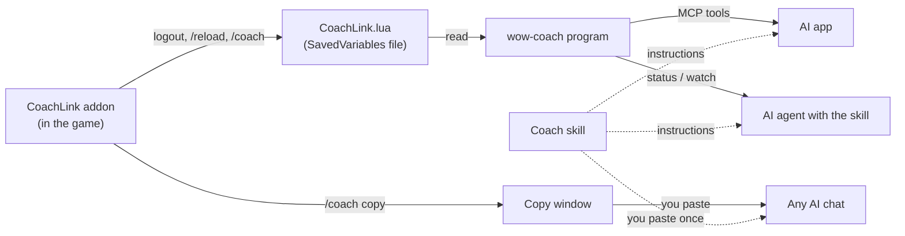

# How wow-coach works

This page explains the pieces of wow-coach, how data moves between them, and what we
verified about WoW Forever. You do not need it to use the project. It helps if you want to
fix something or add a feature.

## The idea in one paragraph

A World of Warcraft addon cannot talk to the internet or to other programs. The only thing it
can do outside the game is **save a Lua file when you log out or type `/reload`**. WoW calls
these files "SavedVariables". So the CoachLink addon writes a snapshot of your character
(level, zone, quests, talents, gear...) into that file. Then one of three things reads it:
you copy it from a window in the game (`/coach copy`), the `wow-coach` program reads the file
and hands it to an AI app (MCP), or an agent runs `wow-coach status`.

## The pieces

| Piece | Where | Language | Job |
|---|---|---|---|
| CoachLink addon | `addon/CoachLink/` | Lua | Builds the snapshot and history, saves them, shows the copy window |
| `wow-coach` program | `src/wow_coach/` | Python 3.14 | Finds and reads the saved file; commands `status`, `characters`, `progress`, `watch`, `check`, `mcp`, `wiki`; the MCP server; player notes and character journals; game lookups |
| Coach skill | `src/wow_coach/assets/skills/wow-coach/SKILL.md` | Markdown | Tells an AI how to coach, including how to plan toward a goal |
| Coach agent | `src/wow_coach/assets/agents/wow-coach.md` | Markdown | A Claude Code agent: runs a whole session (checks setup, starts live mode, asks which character to continue, greets, plans, says goodbye) and brings its own MCP server |
| Tests | `tests/`, `addon/tests/` | Python, Lua | Python tests, and a Lua test run with a fake WoW API |

## Settings, setup and the packaged Claude files

- `wow-coach setup` (`setup.py`) finds the game folder, installs or updates the addon from
  the GitHub release zip of the same version (`CoachLink-<version>.zip`), creates the notebook,
  and with `--claude-code` copies the agent and skill into `~/.claude`. It refuses zips with
  entries outside `CoachLink/` (zip slip), swaps the new addon in before deleting the old one,
  leaves symbolic links (developer copies) alone, and keeps a `.bak` of a different file it
  replaces. It writes only to the game's `Interface/AddOns/CoachLink`, the data folder and
  `~/.claude`.
- The game folder is picked in this order: `--wow-dir`, the `WOW_COACH_WOW_DIR` variable, the
  folder saved in `config.json` (data folder, override with `WOW_COACH_CONFIG_FILE`), then
  auto-detect.
- The agent and skill live inside the package (`src/wow_coach/assets/`) so that `pip` and
  `uvx` installs carry them. The agent starts the MCP server with `uvx` pinned to the release
  tag; `tests/test_release_pins.py` fails if that pin or a docs pin is not the project version.

## Data flow



The addon never sends anything over the network. The AI app you choose sends what it reads to
its AI provider, like anything else you type there.

## Data contract: `CoachLink.lua` (formatVersion 1)

The addon owns this format. The Python reader must accept everything below and must not
crash on missing fields: every field except `savedAt` and `name` is optional, because any
game call can fail in a new game build.

```lua
CoachLinkDB = {
  ["formatVersion"] = 1,
  ["characters"] = {
    ["Testchar-SomeRealm"] = {         -- key is "Name-Realm"
      ["snapshot"] = { ... },          -- see the table below
      ["history"] = { {event}, ... },  -- oldest first, at most 300 entries
      ["progress"] = { {point}, ... }, -- oldest first, at most 500 points (added in 0.5.0)
    },
  },
}
```

### Snapshot fields

| Field | Type | Meaning |
|---|---|---|
| `savedAt` | number | Unix time (seconds) when the snapshot was taken |
| `reason` | string | Why it was taken: `"logout"` (logout, exit or a plain `/reload`) or `"coach"` (the `/coach` command) |
| `name`, `realm`, `race`, `class` | string | Character identity, in the game's language (for example `"Undead"`, `"Mage"`) |
| `classFile` | string | The class in English capitals, the same in every game language (`"MAGE"`) |
| `faction` | string | `"Horde"` or `"Alliance"` |
| `guild` | table | `{ name, rank }`. Missing when not in a guild |
| `level` | number | Character level (1-60) |
| `xp`, `xpMax` | number | XP into the current level, and XP needed for the next |
| `restedXP` | number | Bonus (rested) XP left. Missing means none |
| `resting` | bool | In an inn or a city, where rested XP builds up |
| `money` | number | Copper. 100 copper = 1 silver, 100 silver = 1 gold |
| `zone`, `subZone` | string | For example `"Tirisfal Glades"`, `"Brill"` |
| `mapID` | number | Map id used by the game's UI |
| `x`, `y` | number | Map coordinates 0-100 (missing inside dungeons) |
| `instance` | table | `{ name, type }` while inside a dungeon or raid (`type` is `"party"`, `"raid"`...) |
| `hearth` | string | Where the Hearthstone is set |
| `stats` | table | `{ health, healthMax, power, powerMax, powerType ("MANA"...), attributes = list of { name, value, base }, armor, resistances = list of { school, value }, spellDamage = list of { school, value }, healing, spellCrit, meleeCrit, dodge (percent), attackPower, manaRegen, manaRegenCasting (mana per second) }` |
| `bags` | table | `{ free = n, total = n, containers = list of container }`. `free`/`total` count the backpack and the four bags. `containers` (added in 0.6.0) also lists a reagent bag or keyring when the character has one |
| `quests` | list | `{ questID, title, level, zone, complete (bool), failed (bool), suggestedGroup, objectivesText, objectives = list of { text, done (bool) } }`. `zone` is the quest-log header it sits under; `objectivesText` is the short "Bring 10 ... to ... in Brill" summary, which names who to hand it in to; `suggestedGroup` is set for group quests |
| `completedQuests` | number | How many quests the character has ever finished |
| `talents` | table | `{ unspent = n, trees = list of { name, spent }, picked = list of { name, rank, maxRank } }` |
| `professions` | list | Every Skills-tab line, each name once: `{ name, rank, maxRank, category }`. `category` is the header the line sat under, in the game's language (`"Professions"`, `"Secondary Skills"`, `"Weapon Skills"`, `"Languages"`...). `category` is optional: older snapshots lack it and can list a profession twice |
| `recipes` | list | Remembered (see below). One entry per profession window opened: `{ profession, rank, maxRank, seenAt, recipes = list of { name, color, skillUps } }`. Only learned recipes. `color` is the recipe's color in the window: `"orange"` (sure skill-up), `"yellow"`, `"green"`, `"gray"` (no skill-up) |
| `gear` | list | One item (see below) per worn slot, plus `slot` (`"Chest"`), `durability` and `durabilityMax` |
| `bank` | table | Remembered. `{ seenAt, containers = list of container }`; a container from the account bank has `account = true` |
| `mail` | table | Remembered. `{ seenAt, letters = list of { sender, subject, money, cod, daysLeft, items = list of { name, count, quality } } }` |
| `timePlayed` | table | Remembered from `/played`: `{ total, thisLevel, seenAt }` (seconds) |
| `spells` | list | Names of learned, active spells (strings) |
| `spellBook` | list | Every learned spellbook entry: `{ tab, name, rank, passive (bool) }` |
| `reputations` | list | `{ name, group, standing, value, max, atWar }`: `standing` is the game's word (`"Friendly"`), `value`/`max` the progress inside it. A header the player collapsed in the reputation window is `{ name, collapsed = true }`, because the game hides its factions |
| `currencies` | list | `{ name, quantity }` from the Currency tab |
| `legacy` | table | Forever's Legacy system: `{ renown (reward track level), points (unspent), perks = list of { tree, name, rank, maxRank }, challenges = list of { name, done, description } }` (the class challenges) |
| `auras` | list | Buffs and debuffs right now: `{ name, kind ("buff"/"debuff"), seconds (left; missing = no end), stacks }` |
| `actionBars` | list | `{ slot, kind ("spell", "item", "macro"...), name }`. Slots 1-12 are the main bar; the other bars follow in blocks of 12 |
| `group` | table | `{ kind ("party"/"raid"), members = list of { name, level, class } }`. Missing when alone |
| `pet` | table | `{ name, level, family }`. Missing without a pet |
| `achievementPoints` | number | Achievement points |
| `mounts` | list | Names of the mounts the character owns |
| `errors` | list | Strings naming sections the addon failed to read, for example `"talents: attempt to index nil"` |

**Containers and items.** A container (a bag, a bank tab) is
`{ bag, name, slots, free, account, items = list of item }`. An item is
`{ slot, name, itemID, count, quality, itemLevel, requiredLevel, type, subType, equipSlot, stats, sellPrice, bound, noValue }`:
quality 0 gray, 1 white, 2 green, 3 blue, 4 purple, 5 orange; `type`/`subType` are the
game's words (`"Armor"`/`"Cloth"`, `"Tradeskill"`/`"Cloth"`); `equipSlot` (`"Chest"`) and
`stats` (a list of strings like `"+3 Stamina"`) only exist for things you can wear;
`sellPrice` is copper for one item; `noValue` means vendors won't buy it.

**Remembered fields.** The bank, the mailbox and the recipe lists can only be read while
that window is open, and play time only arrives when the player types `/played`. The addon
reads them at that moment and copies the last thing it saw (with `seenAt`, Unix time) into
every snapshot, so they can be days old. Missing means "never seen yet".

All fields added in 0.6.0 are additive: `formatVersion` stays 1, older readers ignore them,
and saves from older addons simply lack them.

### History event fields

| Field | Type | Meaning |
|---|---|---|
| `time` | number | Unix time (seconds) |
| `kind` | string | `"level"`, `"death"`, `"quest"`, `"login"` |
| `text` | string | A sentence, for example `"Reached level 7"`, `"Died in Brill (level 6)"` |
| `level` | number | Character level at the time |
| `zone` | string | Zone at the time |

### Progress point fields

One point is added to a character's `progress` list every time a snapshot is taken (logout,
`/reload`, `/coach`). It is a small copy of the numbers that show how far the character got,
so the coach can compare sessions without keeping every snapshot. `progress` is additive:
`formatVersion` stays 1, and saves from older addon versions simply have no `progress`.

| Field | Type | Meaning |
|---|---|---|
| `time` | number | Unix time (seconds) of the snapshot |
| `reason` | string | Same as the snapshot's `reason` |
| `level`, `xp`, `xpMax` | number | Level, XP into the level, XP needed for the next |
| `money` | number | Copper |
| `zone`, `subZone` | string | Where the character was |
| `questsDone` | number | How many quests in the log were complete (ready to turn in) at that moment. Missing when the quest log could not be read |

Every field is optional: if a game call fails, the point is still added with what is known.
Rules: at most 500 points (the oldest are dropped), and a point is **not** added when
`level`, `xp`, `xpMax`, `money`, `zone`, `subZone` and `questsDone` are all the same as in the
previous point and it was taken within 60 seconds of it (quick `/reload` series).

### How WoW Forever writes the file (seen 2026-11-06, build 1.60.1)

Checked against the game's own `Blizzard_CombatLog.lua` SavedVariables file:

- Windows line endings (`\r\n`), and the file starts with an empty line.
- No indentation.
- Keys are written as `["text"] = value,` or `[0] = value,` (number keys in brackets).
- List entries are written without a key, one per line, and holes are written as `nil,`.
  Older WoW versions add a comment after list entries: `value, -- [1]`. The reader accepts both.
- Strings use double quotes with backslash escapes (`\"`, `\\`, `\n`).
- Booleans are `true` / `false`; numbers can be integers, decimals, or negative.

## Verified facts about WoW Forever

- Forever (product code `wowf`, codename "camelot" in Blizzard's UI code) runs on the modern
  WoW engine. Its addon API is the retail-style one: `C_QuestLog.GetInfo`,
  `C_QuestLog.GetQuestObjectives`, `C_SkillInfo.GetSkillLineInfo`, `C_SpellBook`. Source:
  Blizzard's UI code, mirrored at https://github.com/Gethe/wow-ui-source (branch `forever`,
  build 1.60.1.70790), folder `Interface/AddOns/Blizzard_APIDocumentationGenerated/`.
- Forever talents are three classic-style trees built on the modern `C_Traits` system.
  Blizzard's Forever talent frame gets the config with
  `C_SpecializationInfo.GetCombatConfigIDForSpecGroup(C_SpecializationInfo.GetActiveSpecGroup())`
  and the per-tree points with `C_Traits.GetGroupDisplayInfoByTreeID` and
  `C_Traits.GetGroupCurrencyInfo`. Source: `Blizzard_PlayerSpells/Camelot/ClassTalents/` in the
  same branch.
- The addon's `.toc` interface number for Forever 1.60.1 is `16001`.
- SavedVariables are written only on logout, `/reload`, or a clean game exit. Killing the game
  loses the write.
- New addon folders are only picked up after a full game restart, not a `/reload`.
- `/coach` saves by reloading the UI, so the file is written without logging out.
- The first `/coach` after you update the addon still saves with the old code, because the
  save runs before the reload.

## The coach's memory: player notes and character journals

The coach keeps two kinds of Markdown file in the data folder (code: `notes.py`):

| File | Holds | Tools |
|---|---|---|
| `coach-notes.md` (the **player notes**) | The person: how much detail they want, click-by-click steps, Questie or not, solo or group, computer notes. Shared by all characters. Same file as in 0.4.0, so an existing notebook keeps working | `save_player_notes` |
| `characters/<Name-Realm>.md` (a **character journal**) | One character: choices (spec, professions), `## Goals` and plans, progress log, open advice | `save_coach_notes` |

- `read_coach_notes(character)` returns both, with headings, and says when the journal does not
  exist yet. Setup creates only the player notes; the coach creates a journal the first time
  it coaches a character.
- Journal file names come from `Name-Realm` with the characters `<>:"/\|?*` and control
  characters replaced by `_` (spaces stay), so they work on Windows, macOS and Linux.
  `WOW_COACH_NOTES_FILE` moves the player notes file, and the `characters` folder moves with it.
- A character is found by its name or `Name-Realm`, case-insensitive. Without a name the most
  recently saved character is used.
- `list_characters` shows each character's first bullet under `## Goals` (or "no journal yet").
  The progress numbers come from the addon's `progress` list, not from the journals:
  `progress_summary` (code: `format_progress` in `report.py`) groups points less than 30
  minutes apart into one play session, starts a session at its login event (from `history`)
  because a session often has just one save point, and estimates XP per hour of play from that.
- Each file is limited to 100 KB. Saving replaces the whole file.

## Game lookups (Warcraft Wiki)

The MCP server (and the `wow-coach wiki` command) can look up game facts so the coach does not
need slow, noisy web searches. Code: `web.py` (downloading), `wiki.py` (the two lookups),
`wikitext.py` (turning the wiki's source markup into plain text).

How it works, in plain words:

1. `search_wiki` asks the wiki's search API for page titles and shows a cleaned one-line
   snippet and the link for each.
2. `read_wiki_page` asks the wiki's parse API for a page's source text, then `wikitext.py`
   pulls the info box (name, level, location...) out, turns coordinates like
   `{{co|61|52|Tirisfal Glades}}` into `Tirisfal Glades 61, 52`, turns links into their text,
   turns tables into `a | b | c` rows, and drops references and HTML.
   Version labels are kept: a banner such as `{{Forever only}}` becomes the note "Marked
   Forever-only on the wiki.", and `{{cw}}` / `{{fw}}` become `[Classic]` / `[Forever]`.
   `{{g|sod}}` (the wiki's game-name template) becomes "Season of Discovery", `{{g|forever}}`
   becomes "Forever".
   Templates the reader does not know never make text vanish silently:
   - Page furniture (navigation boxes, "External links" lists, reference lists, sort keys,
     season banners) is dropped.
   - A template with a plain argument leaves its last plain argument.
   - Any other template, such as an included list like `{{SoD Mage Scroll 20}}`, is first sent
     to the wiki's `action=expandtemplates` API. That is one extra request per page (at most 12
     templates, each answer cut at 3000 characters), and only for pages that have such
     templates. If it fails, the template shows as `[SoD Mage Scroll 20]` so the coach can see
     something was there.
3. Every answer ends with a `Source:` line.

Rules we follow:

- **Source and license.** Only the Warcraft Wiki (https://warcraft.wiki.gg), through its
  official MediaWiki API (`api.php`). Its text is CC BY-SA 4.0, so each answer shows the page
  link and "Warcraft Wiki, CC BY-SA 4.0". The saved responses in `tests/fixtures/wiki/` are
  short real samples used only to test the parser; they carry the same license and come from
  the wiki pages named in their file names.
- **Politeness.** The `User-Agent` is `wow-coach/<version> (+https://github.com/RayanBayat/wow-coach)`.
  Every call adds `maxlag=5` (the wiki may refuse us when its servers are busy). Answers are
  cached in memory for 1 hour, requests to one site are at least 0.5 s apart, and every request
  times out after 10 s. When a request fails the tool returns a plain sentence (for example
  "Warcraft Wiki didn't answer (timeout). Try again or use web search.") and never crashes.
- **robots.txt.** The wiki's `robots.txt` (checked 2026-11-07) allows ordinary agents and
  states `Content-Signal: search=yes, ai-train=no, use=reference`. Lookups for a player's
  question are reference use. We never train on wiki text, never save it to disk (the cache is
  memory only) and never copy the wiki in bulk.
- **Network access is only in `web.py`.** Everything else receives a `fetch` function, so tests
  use saved responses and never touch the internet.

### Why Wowhead is not included

Wowhead has handy public JSON endpoints (a search suggestion list and a tooltip service), and
we looked at using them. We decided not to, on 2026-11-07, for two reasons:

- Wowhead's terms of use (https://corp.fanbyte.com/legal/terms, linked from
  https://www.wowhead.com/forever/tos) say you may not "attempt to access or search the
  Service or download content from the Service using any engine, software, tool, agent,
  device or mechanism (including spiders, robots, crawlers, data mining tools or the like)
  other than the software and/or search agents provided by ZAM or other generally available
  third-party web browsers". A program that queries Wowhead for an AI is that kind of tool.
- Wowhead's pages answer automated requests with 403 (bot protection). Getting around that
  would break the first point and is something this project never does.

So there are no Wowhead tools. If Wowhead publishes an official, permitted API, this can be
revisited.

### What we never do

- Never get around a site's protection: no headless browsers, no cookie or token tricks, no
  pretending to be a web browser.
- Never use a site whose terms forbid automated access.
- Never hide where an answer came from: every lookup ends with a `Source:` line.

## Known limits

- The snapshot is only as fresh as the last logout, `/reload` or `/coach`.
- Quests under a collapsed quest-log header are not saved (`C_QuestLog.GetInfo` only walks
  shown entries). The same goes for factions under a collapsed reputation header; those
  headers are saved with `collapsed = true` so the coach can say so.
- The bank, mailbox, recipe lists and play time are only as fresh as the last time the
  player opened that window (or typed `/played`).
- The Lua test uses a fake game API, so it proves our logic, not Blizzard's behavior.
- There is no live combat data.

## Safety

- The addon uses only the normal addon API. There is no memory reading, no injection and no
  automation, so it is allowed under Blizzard's addon rules like any other addon.
- Every part of the snapshot is read inside a protected call. If one game function breaks in a
  patch, that part is listed under `errors` and the rest still saves.
- The program only reads the saved file. Its only writes are the player notes file and the
  character journals.
- The addon uploads nothing. The program never sends your character anywhere. Its only
  internet use is the wiki lookups above, which send just the words being looked up.
