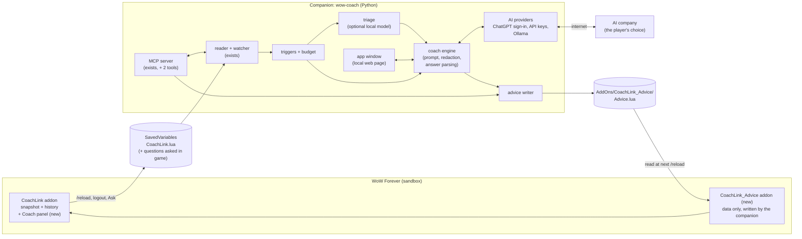

# Plan: the in-game Coach panel and the wow-coach companion app

Status: **draft for the owner's review** (2026-11-08). Nothing here is built yet. Based on
release 0.7.0. Facts marked *verified* were checked in Blizzard's Forever UI source
(github.com/Gethe/wow-ui-source, branch `forever`) or on the official page linked. Everything
else is a design choice, and open choices are listed in "Decisions for the owner" near the end.

## 1. What the player gets

1. **A Coach panel inside the game.** It shows the coach's next 1-3 steps and the latest
   answer, says when it was written and by which AI, and has a box to ask a question.
2. **A companion app on the PC** (the `wow-coach` program, grown up). It reads the save, asks
   the AI the player chose and writes the answer back for the panel. It also shows answers in
   its own window right away, so there is no need to wait for a reload.
3. **Any AI.** Sign in with ChatGPT, or an API key from OpenAI, Anthropic, Google or OpenRouter,
   or a local model through Ollama. The player's existing AI app (Claude Code, ChatGPT,
   anything with MCP) keeps working too.
4. **The player decides when the coach speaks.** By hand (the default), on events such as a
   death, a level-up or full bags, on a timer, or through a small local model that only wakes
   the expensive model when it is worth it. There is a spending cap.

**Not goals:**
- A live chat box inside the game. It is impossible, see 2.1.
- Combat advice. Blizzard is closing that door, see 3.
- Playing for the player in any way.

## 2. Hard limits we design around

### 2.1 The game's addon sandbox (verified)

- An addon has **no network, no file access and no way to start programs**.
  - `URLDocumentation.lua` has only `LaunchURL`, which opens the browser and is restricted.
  - Nothing in `Blizzard_APIDocumentationGenerated/` does HTTP, sockets, files or processes.
- **Data leaves the game only in the SavedVariables file.** WoW writes it at `/reload`, logout
  or exit (docs/design.md).
- **Data enters the game only as addon files, read at load** (login or `/reload`).
  - A running addon can't re-read a file.
  - So an answer shows in the panel only after the next `/reload`. The companion window shows
    it at once.
- **A new file or a new addon folder is only noticed after a full game restart**, not a
  `/reload` (verified in 0.6.0). Each release that adds a file says "restart the game once".
- **Combat:** Forever has Midnight's restrictions.
  - `COMBAT_LOG_EVENT_UNFILTERED` is restricted.
  - Unit facts can be "secret values" (`issecretvalue`).
  - `AddOnRestrictionType` covers Combat, Encounter, ChallengeMode, PvPMatch, Map and Chat.
- **Available for the panel** (verified in the Forever source):
  - `InCombatLockdown`, `Settings.RegisterCanvasLayoutCategory`, `C_AddOns.GetAddOnMetadata`.
  - The minimap **addon compartment**: `Blizzard_Minimap/Camelot/AddonCompartment.lua` on top
    of the shared file that reads `## AddonCompartmentFunc` from an addon's .toc.
  - `Bindings.xml` key bindings, and `SetResizeBounds`.

### 2.2 What we deliberately don't use, even though it might work

| Trick | Why not |
|---|---|
| Reading the screen (an addon draws colored pixels, a program reads them) | The rotation-bot technique. It fits the EULA's ban on software that "reads, or 'mines' information" |
| Loading pre-made "slot" addons on a timer (`C_AddOns.LoadAddOn`) to get answers in without a reload | Built to get around the sandbox. Unproven on Forever, and could break or be closed in any patch |
| Tailing `WoWCombatLog.txt` | Combat data, which Blizzard is cracking down on for overlays. Not needed for coaching |
| Sound files as a signal (`PlaySoundFile`) | Same side-channel idea as the slot addons |
| Pressing keys for the player (even `/reload`) | Automation. Never |

## 3. The rules every change must follow

Each pull request ends with this checklist. Section 9 turns most of it into automatic tests.

**Blizzard UI Add-On Development Policy**
(https://us.forums.blizzard.com/en/wow/t/ui-add-on-development-policy/24534):
- Free of charge, with no premium version and no charging for "services related to the
  add-on". Players pay their own AI company directly; wow-coach never sells AI access.
- Code readable, never obfuscated (MIT, on GitHub).
- No ads and no donation requests in the game. Donation links, if ever, go only on the GitHub
  or CurseForge page.
- No harm to realm performance: no chat spam, no `OnUpdate` polling loops, event-driven only.
- Content inside the game's T rating: the system prompt asks for that, and answers are plain
  text.

**Blizzard EULA**
(https://www.blizzard.com/en-us/legal/fba4d00f-c7e4-4883-b8b9-1b4500a402ea/blizzard-end-user-license-agreement):
- No automation, no memory reading, no code injection and no network interception.
- The companion only reads files the game writes and writes one data addon folder, the same
  model as Raider.IO, TSM and WeakAuras Companion.

**Combat** ("Combat philosophy and addon disarmament in Midnight",
https://worldofwarcraft.blizzard.com/en-us/news/24246290/combat-philosophy-and-addon-disarmament-in-midnight):
- No combat advice and no combat data.
- The panel hides in combat, and the Ask button is off in combat.

**CurseForge**
(https://support.curseforge.com/en/support/solutions/articles/9000197279 and
https://legal.overwolf.com/docs/curseforge/mod-authors-terms):
- Only Lua and XML in the addon zip, never .exe or .py.
- No direct external download links: link the GitHub page instead.

**AI companies:**
- OpenAI: Sign in with ChatGPT is OpenAI's program for open-source apps that run on the user's
  machine (https://github.com/openai/sign-in-with-chatgpt-devkit). API keys are fine too.
- Anthropic: API keys only. Its policy forbids offering a Claude.ai login or routing requests
  through Free, Pro, Max or Ultra plan credentials
  (https://code.claude.com/docs/en/legal-and-compliance).
- Google: Gemini API keys only. Never a consumer Google login: accounts were suspended for
  that.
- Local models: the player downloads them through Ollama under each model's own license.

**Licenses:**
- New dependencies must have licenses compatible with MIT.
- **Don't copy code from the Sign in with ChatGPT DevKit**: its "Noncommercial License v1.0"
  doesn't fit an MIT repo. Implement from OpenAI's public protocol documentation (OAuth 2.0
  with PKCE and a loopback redirect) and check those docs' terms first (decision D5).
- Wiki text keeps its CC BY-SA attribution wherever it is shown.

**Privacy** (the owner is in the EU):
- Everything stays on the player's PC except what goes to the AI company they chose. Say that
  plainly in the app and the README.
- No telemetry, ever.
- Other players' names (group members, mail senders, players who killed you) are replaced with
  "a player" before anything goes to an AI. This is on by default and the player can change it.

## 4. Architecture



### 4.1 Why a separate data addon

- The companion can't write into `CoachLink/`: the CurseForge app overwrites or flags changed
  files (TSM and Raider.IO users meet this).
- So the companion owns its own folder, `Interface/AddOns/CoachLink_Advice/`, made by
  `wow-coach setup`. It holds two files:
  - `CoachLink_Advice.toc`: `## Interface:` copied from CoachLink.toc every time, so it never
    shows as "out of date".
  - `Advice.lua`.
- CoachLink.toc gets `## OptionalDeps: CoachLink_Advice`, so the data loads first. CoachLink
  works the same without it.
- One full game restart is needed after setup creates the folder.

### 4.2 Data contracts (written first, phase 0, so the work can run in parallel)

**C1. Questions from the game** (in SavedVariables, under the character):

```lua
questions = {   -- oldest first, at most 20
  { id = "1794100000-1", text = "What should I do next?", askedAt = 1794100000 },
}
```

- The panel adds one entry, then reloads the UI (that click is the player's).
- The text is at most 500 characters. `id` is time plus a counter.
- Answered questions are pruned once the advice file has an answer with that id.

**C2. The advice file** (`CoachLink_Advice/Advice.lua`, written only by the companion):

```lua
-- Written by wow-coach. Data only, rewritten each time; don't edit.
CoachLinkAdvice = {
  formatVersion = 1,
  writtenAt = 1794100100,
  characters = {
    ["Testchar-Testrealm"] = {
      basedOnSave = 1794100050,      -- savedAt of the snapshot the AI read
      answers = {                    -- newest last, at most 10
        { questionId = "1794100000-1", question = "What should I do next?",
          askedAt = 1794100000, answeredAt = 1794100090,
          source = "ChatGPT (your plan)", title = "Next steps",
          steps = { "Turn in Fields of Grief to Farmer Solliden in Brill.", "..." },
          text = "Longer explanation...", warnings = { "..." } },
      },
      plan = { goal = "Level 20 by Sunday", steps = { "..." }, updatedAt = 1794100090 },
    },
  },
}
```

- **Limits:** a step is at most 300 characters, `text` at most 4000, the file at most 200 KB.
- **Safety (security-critical):**
  - The file is Lua the game runs, so it is written by a serializer that only emits literal
    tables, strings, numbers and booleans.
  - String escaping: `\\`, `\"`, `\n`, and control characters as `\ddd`. `|` is doubled to
    `||` so AI text can't make WoW color codes or clickable links.
  - The file is parsed back with our own Lua-table reader (`lua_table.py`) and compared before
    it is used.
  - Written atomically (a temp file, then `os.replace`), so the game never reads half a file.

**C3. Companion settings** (`settings.toml` in the data folder; never secrets):
- Chosen provider and model, privacy switches, trigger rules, quiet hours and budget caps.

**C4. Secrets** (the operating system's keychain through `keyring`, service `wow-coach`):
- API keys and the ChatGPT refresh token.
- Never in files, logs, SavedVariables or the advice file. Without a keychain (some Linux
  setups), keys live in memory for the session and the app says so. There is no plain-text
  fallback.

**C5. Provider interface** (Python `Protocol`, in `src/wow_coach/ai/base.py`):

```python
class Provider(Protocol):
    name: str                       # "OpenAI (API key)", "ChatGPT (your plan)", "Ollama"...
    def ask(self, messages: list[Message], *, model: str, max_output_tokens: int,
            json_schema: dict[str, object] | None = None) -> Answer: ...
    def check(self) -> str: ...     # "ok" or a plain sentence about what is wrong

@dataclass(frozen=True, slots=True)
class Answer:
    text: str
    usage: Usage                    # input/output tokens, as the provider reported them
```

- Tests use a `FakeProvider`, and no test touches the network.

**C6. Events for triggers** (`src/wow_coach/triggers/contract.py`):
- `Event(kind, character, at, details)` with kinds such as `saved`, `asked`, `died`,
  `died_again_soon`, `level_up`, `quest_done`, `bags_nearly_full`, `new_zone`,
  `talent_points`, `gear_hint`, `durability_low`, `timer`.

### 4.3 The three ways a question flows

1. **Ask in game:**
   - The player types in the panel and clicks **Ask**, which saves the question and reloads.
   - The watcher sees the save (`reason: ask`) and the engine answers.
   - The answer shows in the app window (and Claude Code in live mode) at once, and in the
     panel after the next `/reload`. The panel says "Waiting for your coach. Check again
     (reloads) in a moment, or look at the wow-coach window."
2. **Ask in the app window:** the engine uses the newest save (and says how old it is). The
   answer shows at once, and is also written to the advice file.
3. **Automatic:**
   - A save produces events, and the rules decide: off, just notify, ask the cheap model, or
     ask the big one.
   - The optional triage model reads the events plus the player's own words ("only wake the
     coach if I die twice in 10 minutes") and answers WAKE or SKIP with a reason.
   - Cooldowns, quiet hours and the spending cap always apply first.

## 5. The addon side (Lua)

- **Files:**
  - New `CoachLinkPanel.lua`: one more file, so one game restart. Listed in the .toc after
    `CoachLink.lua`.
  - New `Bindings.xml`.
  - `CoachLink.lua` gets only the question store and the `ask` reason.
- **Window:**
  - Movable and resizable, with a remembered position and size (`CoachLinkDB.settings`). Esc
    closes it, using `UISpecialFrames` like the copy window.
  - Contents: next steps (numbered), the latest answer (scrollable), the ask box, and a footer
    ("From ChatGPT, 5 min ago, based on your save from 21:02. AI can be wrong.").
- **Opening it:** `/coach panel`, an addon compartment entry (`## AddonCompartmentFunc`), and
  a key binding. On login or reload, a single chat line says "new advice from your coach",
  only when something is new.
- **Combat:**
  - The panel hides on `PLAYER_REGEN_DISABLED` and comes back afterwards if it was open.
  - Ask is disabled in combat. Nothing runs during combat.
- **Taint safety:**
  - No secure templates and no protected calls. `ReloadUI()` only runs from a click or key
    press.
  - Frames are named `CoachLink...`, and no Blizzard frame is changed.
- **Performance:** event-driven only, no `OnUpdate`. The text is built once per load.
- **Settings** (`Settings.RegisterCanvasLayoutCategory`): font size, and "show the panel when
  new advice arrives".
- **Strings:** all player-facing text sits in one table, ready for other languages later.

## 6. The companion side (Python)

| Module | Job |
|---|---|
| `advice/serialize.py`, `advice/writer.py`, `advice/install.py` | The safe Lua serializer and atomic writer (C2); create or refresh the `CoachLink_Advice` folder |
| `advice/questions.py` | Read the questions not yet answered from the save (C1) |
| `ai/base.py` | The contracts (C5), `FakeProvider` |
| `ai/providers/openai_key.py`, `anthropic_key.py`, `gemini_key.py`, `openrouter.py`, `ollama.py` | One small class each. OpenRouter and Ollama use OpenAI-compatible endpoints |
| `ai/chatgpt_signin.py` | Sign in with ChatGPT: OAuth PKCE with a 127.0.0.1 loopback and a fixed port; the access token in memory, the refresh token in the keychain; sign out revokes |
| `ai/pricing.py`, `budget.py` | A dated price table (the player can edit it), a usage ledger (`usage.jsonl`), daily and monthly caps; stops at plan limits (HTTP 429) |
| `secrets.py` | Keychain access (C4) with redaction helpers |
| `coach_engine.py` | Build the prompt: coaching rules from SKILL.md, the status report, history, journal, player notes and the question. Redact other players' names. Ask for a JSON answer (steps, text, warnings). Store the conversation (`conversations/<Name-Realm>.jsonl`). Write the advice |
| `triggers/` | Snapshot diff into events (C6), rules, cooldowns, quiet hours, timer; triage through any `Provider` (Ollama on the CPU by default) |
| `app/` | `wow-coach app`: a local web page (section 7) |
| `server.py` (exists) | Two new MCP tools: `questions_from_game(character)` and `send_advice_to_game(character, title, steps, text)`, so today's Claude Code coach can fill the panel |
| `cli.py` (exists) | `wow-coach ask "..."`, `wow-coach app`, `wow-coach signin chatgpt`, `wow-coach keys` |

**Prompt injection:**
- Mail subjects, other players' names and wiki text are untrusted. They are fenced in tagged
  blocks, and the instructions say to treat them as data.
- The model has no tools that act: it only returns text, which only the player sees. So the
  worst case is a bad answer, never an action.

**Local triage model:**
- Optional and off by default, through Ollama.
- Runs on the CPU by default, so it never takes video memory from the game. On an 8 GB card a
  4B model takes about 6 GB.
- A 1B-4B model answers WAKE or SKIP in a few seconds. If it fails or times out, the plain
  rules decide.

## 7. The app window (security matters here)

- `wow-coach app` starts a small web server **on 127.0.0.1 only**, on a random port, and opens
  the browser at `http://127.0.0.1:<port>/#<one-time token>`. Plain HTML, CSS and JS, with no
  build step.
- **Protections:**
  - Check the `Host` header, against DNS rebinding.
  - A session cookie (`SameSite=Strict`, `HttpOnly`) plus a CSRF header on every request that
    changes something.
  - No CORS, and a strict Content-Security-Policy with no inline scripts.
  - Keys are typed into a form and go straight to the keychain. They are never echoed back.
- **Screens:**
  - Coach: chat and the next steps.
  - Connect an AI: sign in, keys, test buttons.
  - When to speak: triggers, the triage model, quiet hours.
  - Spending: the ledger and the caps.
  - Privacy: what is sent where.
- **Later options:** desktop notifications ("Your coach answered") and text-to-speech
  (decision D8).

## 8. Milestones (each one is a release that works by itself)

| Release | Scope | Done when |
|---|---|---|
| **0.8.0 Coach panel** | The panel, Ask in game, the advice file and data addon, `setup` creating it, MCP tools `questions_from_game` and `send_advice_to_game`, the live-mode agent answering `reason: ask`, `wow-coach ask` with one API-key provider | In game: ask, then Claude Code (or `wow-coach ask`) answers, then after `/reload` the panel shows it. Restart once after the update. All tests pass, and the compliance tests (9) pass |
| **0.9.0 Companion app** | `wow-coach app`, all providers, Sign in with ChatGPT, keychain, budget and ledger, conversation history | A player with no terminal knowledge (beyond one install line) can connect an AI and get answers in the window and the panel |
| **0.10.0 When to speak** | Triggers, rules, the timer, quiet hours, optional triage, notifications | Defaults are manual only. Each automatic rule respects cooldowns and caps, shown by tests |
| **1.0.0 Easy install + CurseForge** | Installers (decision D4), CurseForge "Forever" listing for CoachLink, privacy page, user guide with screenshots | Listed on CurseForge. A fresh Windows PC goes from zero to an answer in about 10 minutes |

## 9. Tests, including compliance tests

- **Python:**
  - pytest, mypy --strict and ruff, as now.
  - Provider tests use recorded responses, not the network.
  - The serializer gets property tests (`hypothesis`): any string survives the round trip,
    and no output ever has more than one top-level statement.
- **Lua:** the panel gets its own harness, `addon/tests/run_panel_test.lua`, so it never
  clashes with `run_addon_test.lua`. It uses fake frames, checks combat hiding, and loads a
  real advice file written by the Python writer (an end-to-end test).
- **Compliance tests** (`tests/test_compliance.py`) that fail the build:
  - The addon's Lua never calls chat-sending functions (`SendChatMessage`,
    `C_ChatInfo.SendAddonMessage`).
  - It never runs macros, casts, targets, uses actions, clicks secure buttons or calls
    `SetBinding`.
  - It never calls `C_AddOns.LoadAddOn` or `PlaySoundFile` with a file path, and never sets an
    `OnUpdate` handler.
  - The Python code never imports input or screen tools (`pyautogui`, `pynput`, `keyboard`,
    `mss`, `PIL.ImageGrab`, `win32api`/`SendInput`) or reads another process's memory.
  - No code mentions consumer OAuth endpoints of Claude.ai or Google.
  - The advice writer refuses any path outside `AddOns/CoachLink_Advice/`.
  - Secrets never appear in files written by the app (tests with fake keys).
- **In game** (the owner, because agents can't run the game): a short checklist per release.
  Never close the game by force; quit through the menu. No big disk work on `/data` while it
  runs (the advice file is a few KB).

## 10. How we build it: parallel work that doesn't collide

### 10.1 Branches and folders

- **`feat/coach-panel`**: the integration branch, from `main` at v0.7.0. Only the integrator
  (the lead agent, Opus) commits here: the contracts, merges, and the **shared files** below.
- **One branch and one git worktree per workstream** (`ws/<letter>-<name>`). Each is created
  by the Agent tool with worktree isolation, from `feat/coach-panel`, so every agent has its
  own folder and its own `.venv`.
- **Shared files: only the integrator edits them.** Agents write the change they need into
  their final report instead:
  - `pyproject.toml`, `uv.lock`, `CHANGELOG.md`, `README.md`, `AGENTS.md`, `docs/design.md`,
    `SKILL.md`, `agents/wow-coach.md`
  - `addon/CoachLink/CoachLink.toc`, `CoachLink.lua`
  - `server.py`, `cli.py`, `setup.py`, `.github/workflows/`
- **All new dependencies are added in phase 0**, with exact latest versions, so no agent ever
  touches `uv.lock`.
- **Agents:**
  - Commit on their own branch, with every gate green. No push, no merge.
  - No attribution lines. No personal data (the existing grep gate).
  - Never touch the real game folder. Tests use temporary folders only.

### 10.2 Workstreams, owners and models

| ID | Workstream | Owns (only these paths) | Model | Phase |
|---|---|---|---|---|
| 0 | Contracts, dependency pins, .toc lines, CI job for the panel test, `FakeProvider`, compliance test skeleton | shared files, `ai/base.py`, `advice/contract.py`, `triggers/contract.py`, `tests/test_compliance.py` | Opus (lead) | 0 |
| A | Coach panel (Lua) | `addon/CoachLink/CoachLinkPanel.lua`, `addon/CoachLink/Bindings.xml`, `addon/tests/run_panel_test.lua` | Sonnet | 1 |
| B | Advice serializer, writer, data addon install, questions reader | `src/wow_coach/advice/*` except `contract.py`, `tests/test_advice_*.py` | Sonnet | 1 |
| C | API-key providers, pricing, budget | `src/wow_coach/ai/providers/*`, `ai/pricing.py`, `budget.py`, their tests | Sonnet | 1 (0.8.0 needs one provider; the rest in 0.9.0) |
| D | Sign in with ChatGPT, keychain | `ai/chatgpt_signin.py`, `secrets.py`, their tests | Sonnet, then an Opus security review | 2 (0.9.0) |
| F | Coach engine (prompt, redaction, JSON answers, conversations) | `coach_engine.py`, `tests/test_coach_engine.py` | Sonnet | 2 |
| G | App window | `src/wow_coach/app/*`, `tests/test_app_*.py` | Sonnet, then an Opus security review | 2 (after F's API is merged) |
| E | Triggers, rules, triage | `src/wow_coach/triggers/*` except `contract.py`, their tests | Sonnet | 3 (0.10.0) |
| H | Installers and packaging | `packaging/*`, the release workflow (integrator merges it) | Sonnet | 4 (1.0.0) |
| M | Mechanical chores: version pins, link checks, fixture trimming, CurseForge text, doc tidy | as assigned per task | **Haiku** | any |

**What runs in parallel:**
- 0.8.0: A, B and C1 (one provider).
- 0.9.0: C (the rest), D and F, then G.
- 0.10.0: E alone.

These sets never share a file, and each depends only on the phase 0 contracts. That's why the
contracts come first.

### 10.3 Order of work in each milestone

1. **Phase 0 (lead):** write the contracts and stub modules with failing tests, pin the new
   dependencies, add the .toc lines and the CI job. Commit to `feat/coach-panel`.
2. **Phase 1 (parallel agents):** each agent gets a brief with its goal, owned paths, contracts,
   rules (sections 3 and 10.1), and "test first". Each reports its branch, commits, gate output
   and integration notes.
3. **Review:**
   - Security-sensitive branches (B, D, G) get a fresh-context Opus review that sees the code,
     not the author's conclusions.
   - Findings go back to the same agent (SendMessage), which keeps its context.
4. **Merge (lead):** in dependency order (B, then C, then A for 0.8.0), with `--no-ff`. All
   gates run after each merge, then the end-to-end test.
5. **Shared files (lead):** design.md, the CHANGELOG, README and skill. Haiku does the
   mechanical parts.
6. **Owner's in-game check**, then release: tag `v0.X.0`, and the release workflow builds the
   zip.
7. **Clean up:** delete the merged workstream branches and worktrees.

### 10.4 Cost control

- Sonnet does the building, Haiku the chores, and Opus only contracts, reviews and
  integration.
- One agent per workstream, at most 3 or 4 at once.
- Briefs point at files instead of pasting them.
- The repo's own AI calls (the providers) are never exercised for real in tests. A real-key
  smoke test happens only by hand, with the owner's OK.

## 11. Risks

| Risk | What we do |
|---|---|
| Two reloads per in-game question feel slow | The app window shows answers at once. The panel says clearly what to do |
| A patch changes an API | Every reader runs protected (as now). The compliance and harness tests catch API use in one place |
| CurseForge rejects the companion link | Link the GitHub page, not a file. Ask CurseForge support before 1.0 |
| AI costs surprise the player | Caps on by default, the ledger is visible, manual-only by default |
| Wrong advice | Every answer says which AI wrote it and "can be wrong". Wiki facts carry their source link |
| Being seen as "AI slop" | Open code, tests and CI, an honest changelog and privacy page. Say openly that AI helped build it |
| Linux keychain missing | Keys in memory only, with a clear message. Never plain text |
| Sign in with ChatGPT access is gated or changes | API keys always work. Test with the owner's account before 0.9.0 |

## 12. Decisions for the owner

| # | Question | Recommendation |
|---|---|---|
| D1 | App window technology | A local web page in the browser (0.9.0). A native window (`pywebview`) can come later |
| D2 | AI client code | The official SDKs: `openai` (also for OpenRouter and Ollama), `anthropic`, `google-genai`. They are maintained and typed. The alternative is small hand-written `httpx2` clients |
| D3 | Providers in 0.8.0 | One: OpenAI API key (simplest to test). Everything else in 0.9.0 |
| D4 | Installers for 1.0.0 | Start with the `uvx` one-liner (free). Signed Windows and macOS installers cost money each year for code signing; decide before 1.0 |
| D5 | Sign in with ChatGPT license | Implement from OpenAI's protocol docs, never copy DevKit code. Check the docs' terms and test with your account first |
| D6 | Ask Blizzard's UI team for a written view before CurseForge | Yes, before 1.0.0 (the address is in the addon policy) |
| D7 | Push workstream branches for CI on 3 systems, or keep them local | Local until the merge; the integration branch gets pushed for CI before each release |
| D8 | Text-to-speech and desktop notifications | Notifications in 0.10.0, speech later and optional |
| D9 | Does Ask reload by itself? | Yes: the click saves and reloads, like `/coach`. The panel says so on the button |
